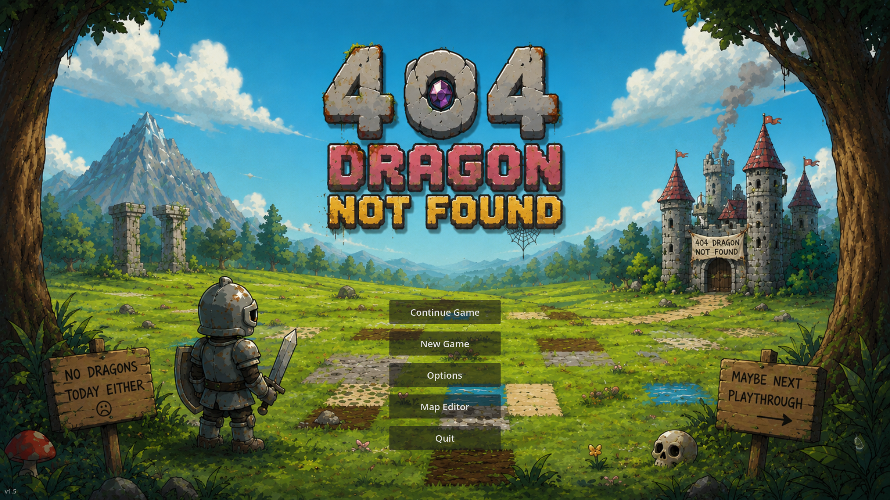

# 404: Dragon Not Found

A small rogue-like / top-down RPG engine built with **Godot 4.6** (GDScript, GL Compatibility renderer).

> **Status: work in progress, proof of concept.**
> This is a starter kit, not a finished game. Most of the systems a rogue-like
> needs are in place: an endless procedural world, fog of war, inventory, crafting,
> trading, quests, turn-based combat and levelling. They are not yet tied together
> into a real game loop. You can walk around, fight, trade and craft, but there is
> no goal, no ending and no real failure state yet.



## Features

- **Endless procedural world.** The map is streamed in 16×16-cell chunks around the
  player. Six biomes (Plains, Fields, Caves, Sea, Rockies, Snow) come from
  altitude and temperature noise. Every chunk you visit is saved.
- **Fog of war** with unexplored, dim, partial and visible levels, kept between sessions.
- **Player avatar**: an animated 8-direction knight that you move with the keyboard
  or by clicking (A* pathfinding).
- **Inventory** with stacking, sorting and dropping, plus a **5-slot quick-use belt**
  for potions (keys 1–5).
- **About 240 item types**, chests, and a **forge** that crafts from shapeless
  recipes defined in [data/forge_recipes.json](data/forge_recipes.json).
- **NPCs**: wandering knights, and melee NPCs that run **shops** (coin-based buy and
  sell) and give **fetch quests** (quest journal, minimap tracking, weekly cooldown).
- **Turn-based combat** against **84 monster species**, with initiative, monsters
  that act more than once per turn, attack / defend / flee, and potions during battle.
- **Levelling and perks.** Each level-up offers 3 random perks to choose from (11
  perks such as Strong, Vampiric, Berserker, Quick and Trader).
- **Calendar and clock.** A day lasts 20 real minutes and the calendar is a fantasy
  one. A day/night tint changes with the seasons, and you can wait to pass time.
- **Map editor** (from the main menu): paint terrain on two layers, place objects,
  monsters and chests, set brush sizes, use an eyedropper, undo with Ctrl+Z, and autosave.
- **Developer tools**: an in-game console, an F3 debug overlay and an F4 collision view.
- Music, sound effects, minimap, monster bestiary, and NPC small talk drawn from fortune-cookie files.

## Getting started

1. Install [Godot 4.6](https://godotengine.org/download) (standard build; .NET is not needed).
2. Clone this repository and open `project.godot` in Godot.
3. Press **F5**. The game opens on the main menu (`scenes/menu.tscn`).

There is also a **Web** export preset that outputs to `export/index.html`.

## Controls

| Key | Action |
|---|---|
| WASD / arrows | Move |
| Left click | Walk to the clicked spot |
| E | Interact / pick up / talk / open |
| F | Fight a nearby monster |
| Ctrl | Fire a projectile (visual only for now) |
| 1–5 | Use a belt slot |
| I | Inventory |
| C | Character sheet |
| Q | Quest journal |
| M | Minimap |
| B | Monster book |
| T | Wait / pass time |
| F10 / Esc | Pause menu (save, main menu, exit) |
| ` (backtick) | Developer console (`/help` lists the commands) |
| F3 / F4 | Debug overlay / collision shapes |

## Project layout

```
scenes/            menu, main game and map editor scenes
scripts/
  actors/          avatar, NPCs, monsters, sprite animators
  world/           chunk streaming, generation, biomes, clock, pathfinding, NPC spawning
  fog/             fog-of-war data, rendering, persistence
  data/            plain data models (cells, chunks, stats, perks, monsters)
  objects/         map objects, items, chests, forge, recipes
  inventory/       inventory and belt models
  quest/           QuestManager autoload and quest instances
  ui/              all in-game windows and HUD (built in code)
  editor/          map editor
  utils/           save manager, texture cache
data/              JSON game data (forge recipes)
fortunes/          quote files used for NPC small talk
media/, sounds/    third-party art and audio
tools/             one-off editor scripts
docs/              design documentation
```

## Documentation

- [docs/DESIGN.md](docs/DESIGN.md): an overview of the architecture and systems, and the current state of the project.
- [docs/superpowers/specs/](docs/superpowers/specs/): detailed design specs for individual features.
- [docs/superpowers/plans/](docs/superpowers/plans/): implementation plans for those features.

## Save data

Game state is saved as JSON under Godot's `user://` directory. On Windows this is
`%APPDATA%\Godot\app_userdata\<project name>\`. Choosing **New Game** in the main menu
deletes the previous save.

## License

The **code, scenes, data and documentation** in this repository are released under the
[MIT License](LICENSE).

### Third-party assets

The art, audio and quote files under `media/`, `sounds/` and `fortunes/` are
**not** covered by the MIT license. They belong to their original authors. Every
bundled pack is used by the game:

| Folder | Used for | License |
|---|---|---|
| `media/chests/` | Chest sprites | PixelExplosive. Custom license (`LICENSE.txt`): free to use, **no redistribution** |
| `media/rpg-tiles/` | Terrain tiles and the tile index (`index.json`) | No license file |
| `media/cobbleset/`, `media/hyptosis/`, `media/lpc_terrain/` | Extra terrain tiles (loaded through `rpg-tiles/index.json`) | No license file |
| `media/rockz/` | Rock obstacle sprites | No license file |
| `media/raven-objects/`, `media/items2/`, `media/kyrise/`, `media/ravenmore/`, `media/flare/`, `media/materials/` | Item and object icons | No license file |
| `media/knight-basic/` | Player avatar animations | No license file |
| `media/knight-greatsword/` | Knight NPC animations | No license file |
| `media/melee/` | Villager NPC animations | No license file |
| `media/rpg-beings/` | Monster sprites | No license file |
| `media/cursors/` | Mouse cursor, quest marker | No license file |
| `media/music/` | Background music (the filenames suggest Pixabay) | No license file |
| `media/title/` | Title screen art | No license file |
| `sounds/RPG Sound Pack/` | Sound effects | No license file |
| `fortunes/` | NPC small-talk quotes | No license file |

For every pack marked "No license file", look up the original source and its terms
before you reuse or redistribute it.

> ⚠️ Some of these packs do not allow redistribution. Before you publish this
> repository or a build of it, check every asset pack's terms and replace or remove
> any asset whose license does not allow it.
